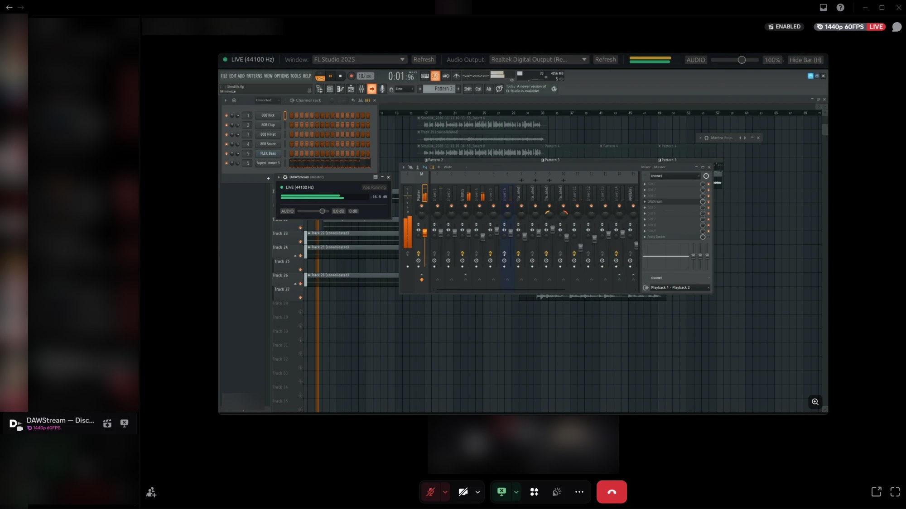
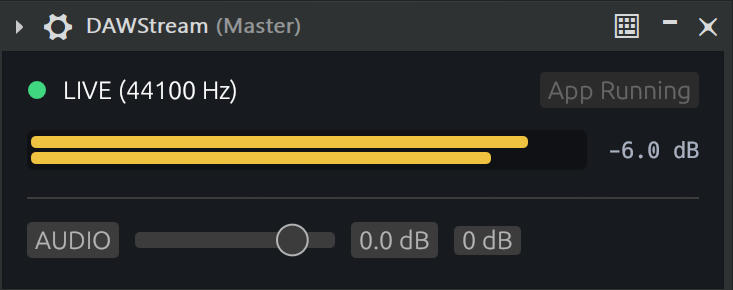
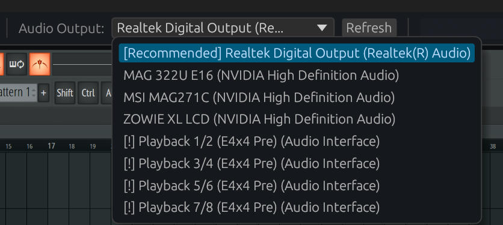

<h1 align="center">
  <picture>
    <source media="(prefers-color-scheme: dark)" srcset="assets/wordmark-dark.svg">
    
  </picture>
</h1>

You share your DAW on Discord and your friends see it but hear nothing. That's because your DAW plays through ASIO and Discord can't hear ASIO.

DAWStream fixes that. Put the plugin on your master, open the app, share the app's window in Discord. Your friends get the screen and the sound. You keep monitoring through your interface like always.

No Voicemeeter, no VB-Cable, no OBS. Windows only.

## Setup

1. Download the zip from [Releases](../../releases), unzip it, run `Install.bat`.
2. Rescan plugins in your DAW and put **DAWStream** last on the master.
3. Click **Open App** in the plugin.
4. In the app, set **Audio Output** to something you're not listening on. Your monitor's speakers or `Realtek Digital Output` are good picks (the app marks them `[Recommended]`).
5. In Discord: **Share Screen → Applications → DAWStream**.

When it's working, both the plugin and the app say **LIVE**:

A few things worth knowing:

- Press **H** in the app to hide the top bar so people only see your DAW.
- **AUDIO** and the slider in the plugin only affect what the stream hears, not your own mix.
- Save the plugin in your default template and you never have to think about it again.

## Troubleshooting

**I hear everything twice.**
The app's Audio Output is set to the interface you're listening on (it shows `[!]` next to those). Pick another one:

**I don't have a spare output.**
Install [VB-Cable](https://vb-audio.com/Cable/) and pick `CABLE Input`. That's it, no routing.

**The plugin doesn't show up.**
Your DAW probably only scans `C:\Program Files\Common Files\VST3`. Right-click `Install.bat` → *Run as administrator*, then rescan.

**The app says "Waiting for Plugin".**
The plugin isn't on the master, or your DAW's audio engine is off.

**The plugin says "Standby".**
You have DAWStream loaded in more than one place. Click **Take Over** on the one you want to stream.

**The stream video is frozen.**
Your DAW is minimized. It can be behind other windows, just not minimized.

**Pro Tools?**
Doesn't work. Pro Tools only loads AAX plugins.

---

Building from source: `cargo xtask bundle dawstream-vst3 --release` for the plugin, `cargo build --release -p dawstream-app` for the app. License: [GPL-3.0](LICENSE).
